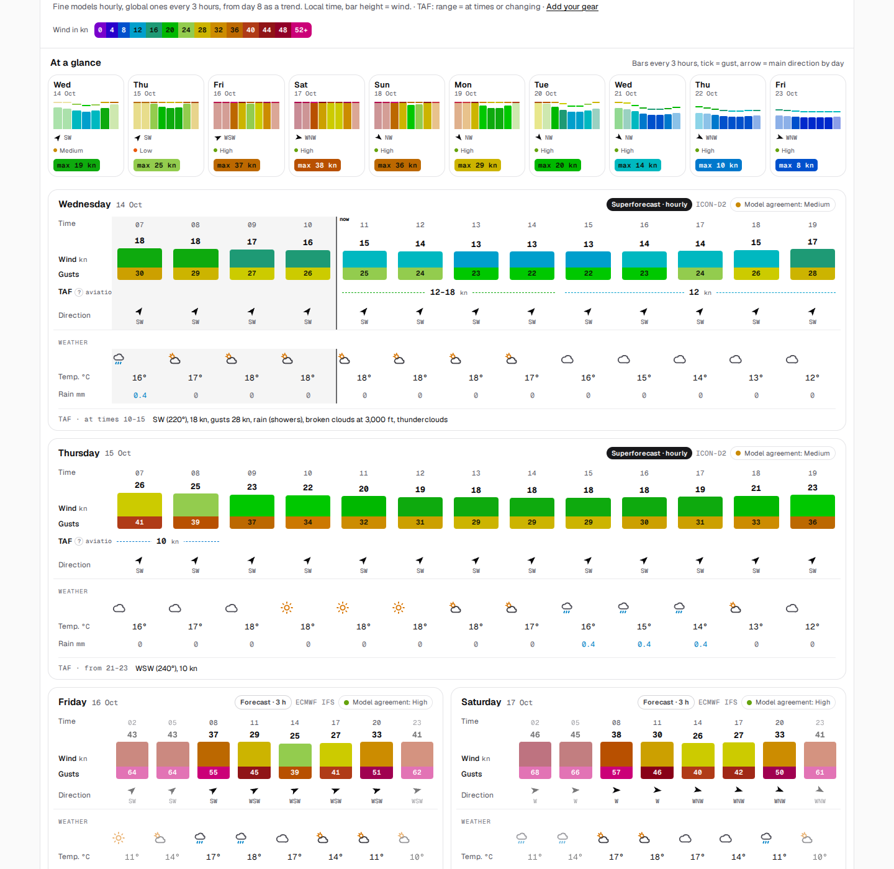

<div align="center">


<h1>Windfenster: open-source wind forecast and live wind map for kitesurfing, windsurfing and wing foiling</h1>

**Self-hosted wind forecast for water sports: measured wind, five weather models and an animated wind map, for every wind station and any spot on earth.**<br>
Each station shows what it measures now, what the models predict for ten days, and which model was closest to the measurements there.<br>
An open-source alternative to Windfinder and Windy: one Docker container, no cloud, no tracking, no API key.

[](https://github.com/firsttris/windfenster/actions/workflows/ci.yml)
[](https://github.com/firsttris/windfenster/releases/latest)
[](https://hub.docker.com/r/tristanteu/windfenster)
[](https://hub.docker.com/r/tristanteu/windfenster)
[](https://hub.docker.com/r/tristanteu/windfenster/tags)
[](https://firsttris.github.io/windfenster/)
[](LICENSE)


```bash
curl -O https://raw.githubusercontent.com/firsttris/windfenster/main/compose.yaml && docker compose up -d
```

[Install](#-install) •
[Features](#-features) •
[Screenshots](#-screenshots) •
[Alternatives](#-windfenster-and-the-alternatives) •
[FAQ](#-faq) •
[Documentation](https://firsttris.github.io/windfenster/)


</div>

## 💡 Why Windfenster?

Kiters and windsurfers check three apps before every session: one for the forecast, one for the
live wind at the spot, one for the map. None of them says which weather model is actually right
at *your* spot, and none runs on your own server.

- **Know which model to trust**: every model is checked against the station's measurements every
  hour; the page opens with the one that was closest there in the last 30 days.
- **Forecast, measured and TAF in one table**: see at a glance whether today's forecast is
  holding, hour by hour.
- **A wind map that is fine where it matters**: ICON-D2 at 2.2 km blended into ICON global and
  ECMWF without an edge, worldwide, ten days ahead.
- **"It works from 2 to 5 pm"**: your spot's wind directions and your kites and wings turn the
  forecast into a window, with a push or e-mail when it comes.

Runs on a Linux server, a NAS (Synology, Unraid) or a Raspberry Pi 4/5, amd64 and arm64; used in
any browser on desktop and phone, installable as an app.

## 🚀 Install

With Docker Compose:

```bash
mkdir windfenster && cd windfenster
curl -O https://raw.githubusercontent.com/firsttris/windfenster/main/compose.yaml
docker compose up -d
```

Open `http://localhost:8080`. The first station lists, measurements and model runs come within
minutes; the map's basemap and relief follow in the background. Podman Quadlet, a reverse proxy or
Cloudflare Tunnel, settings, disk space and backups are in the
[installation guide](https://firsttris.github.io/windfenster/installation.html).

## ✨ Features

### 🌬️ Forecast for every station and spot

- **Every METAR airport in the world and every DWD wind station**, plus any point by map click or
  search.
- **The ten days at a glance**: three-hourly wind bars with gusts, main direction, strongest
  wind and the models' agreement per day.
- **Day cards**: wind as a growing bar with the gust under it, direction, your gear, measured and
  TAF to compare, weather; hourly for today and tomorrow.
- **Five models** (ICON-D2, AROME, HARMONIE, ECMWF, GFS) and the **Windfenster mix**, weighted by
  how well each model hit at the station.
- **Knots, m/s or km/h**, German and English, light and dark.

### 📈 Measured and verified

- **Live wind** every 10 minutes, the raw METAR translated, the **TAF in plain words**.
- **Model ranking per station** ("Who hits here?") and automatic model choice from 30 days of
  verification.
- **History** of the last ten days and **ten years of wind statistics** per month (wind rose,
  windy days).
- **Water levels** from PEGELONLINE and the estimated current on the Rhine.

### 🗺️ Animated wind map

- **Three models at once**, the finest on top, blended without seams; wind or gusts.
- **WebGL particles** that move with the map when you pan and zoom, colour field in the
  Windfinder scale.
- **Stations with their live wind**, water gauges, a spot card with the coming hours, timeline,
  keyboard shortcuts, shareable links.
- **Own basemap from OpenStreetMap** with relief, cut by the server itself: no map service, no
  key.

### 🔔 Spots, gear and alarms

- **Passkeys** or e-mail and password.
- **Saved spots** with the wind directions that work there.
- **Your kites, wings, sails**: the forecast shows what fits each hour.
- **Wind alarms** ahead from the forecast or live from the station, by Web Push and e-mail.

## 📸 Screenshots

<table>
  <tr>
    <td></td>
    <td></td>
  </tr>
  <tr>
    <td></td>
    <td></td>
  </tr>
  <tr>
    <td></td>
    <td></td>
  </tr>
</table>

## 🔀 Windfenster and the alternatives

Windfenster is made for riders who want the forecast, the measurements and the map in one place,
on their own server.

| | What it is | Where Windfenster differs |
|---|---|---|
| [Windfinder](https://www.windfinder.com/) | wind forecasts and live stations, app and website | open source and self-hosted; shows which model was right at each station; measured and TAF in the forecast table |
| [Windy](https://www.windy.com/) | weather map with many models and layers | focused on wind for water sports; ICON-D2 blended into the global models; spot alarms with your gear |
| [Windguru](https://www.windguru.cz/) | forecast tables per spot | model ranking from verification instead of choosing by hand; live wind and history next to it |
| [Open-Meteo](https://open-meteo.com/) | open weather API | Windfenster is an app on top of it, adding measurements, verification, a map and alarms |

## ❓ FAQ

### Is there an open-source alternative to Windfinder and Windy?
Yes: Windfenster is AGPL-licensed, runs as one Docker container and uses only open data. More in
the [FAQ](https://firsttris.github.io/windfenster/faq.html).

### Which weather model is best for kitesurfing at my spot?
Windfenster tells you: it compares every model with the station's measurements every hour and
ranks them per station. [How it works](https://firsttris.github.io/windfenster/forecasts.html#verification-and-ranking).

### Can I get a wind alarm for my spot?
Yes, by push and e-mail, ahead from the forecast or when the station measures it, optionally only
when your gear fits. [Alarms](https://firsttris.github.io/windfenster/accounts.html#alarms).

### Does it work outside Germany?
Yes: the map and the global models cover the world, and every airport with METAR reports is a
station. The 1.5–2.2 km models cover Europe.

### Is it free?
Yes, for private use. Open-Meteo's free API is non-commercial; commercial instances need an
Open-Meteo subscription or their own Open-Meteo.

## 📚 Documentation

The full documentation, with search, is at **[firsttris.github.io/windfenster](https://firsttris.github.io/windfenster/)**.

| | |
|---|---|
| [User guide](https://firsttris.github.io/windfenster/user-guide.html) | station pages, the forecast, the map, spots and alarms |
| [Installation](https://firsttris.github.io/windfenster/installation.html) | Docker Compose, Podman Quadlet, reverse proxy, Cloudflare Tunnel, backups |
| [Configuration](https://firsttris.github.io/windfenster/configuration.html) | every setting |
| [Architecture](https://firsttris.github.io/windfenster/architecture.html) | how the pieces fit together |
| [The wind map](https://firsttris.github.io/windfenster/wind-map.html) | from GRIB2 to WebGL particles |
| [Forecasts and models](https://firsttris.github.io/windfenster/forecasts.html) | models, verification, ranking, the mix |
| [API](https://firsttris.github.io/windfenster/api.html) | the JSON API |
| [Development](https://firsttris.github.io/windfenster/development.html) | building, checks, tests, releases |

## 🛠️ Development

Requires Rust (stable), Node.js 22.12 or newer and pnpm.

```bash
git clone https://github.com/firsttris/windfenster && cd windfenster
pnpm install
pnpm dev     # server on :8080, web app with hot reload on :5173
```

Rust (axum, SQLite, sqlx) with the React app (Vite, TanStack Router and Query, Tailwind, MapLibre,
WebGL2) built into one binary. Architecture, tests and releases:
[Development](https://firsttris.github.io/windfenster/development.html).

## 🤝 Contributing

Issues and pull requests are welcome. A good bug report names the station or place, the time and
what you expected; for the map, the browser and graphics card. Please run the checks listed in
[Development](https://firsttris.github.io/windfenster/development.html) before opening a pull
request.

## 📡 Data sources

Weather data by [Open-Meteo.com](https://open-meteo.com/) (CC BY 4.0), [DWD Open Data](https://opendata.dwd.de/)
(CC BY 4.0) and [ECMWF open data](https://www.ecmwf.int/en/forecasts/datasets/open-data) (CC BY 4.0);
METAR and TAF from the [Aviation Weather Center](https://aviationweather.gov/); water levels from
[PEGELONLINE](https://www.pegelonline.wsv.de/); map data © [OpenStreetMap](https://www.openstreetmap.org/copyright)
contributors via [Protomaps](https://protomaps.com/); relief from [Mapterhorn](https://mapterhorn.com/attribution).
Every source with its licence: [Data sources](https://firsttris.github.io/windfenster/data-sources.html).

---

<div align="center">

⭐ Like Windfenster? A [star on GitHub](https://github.com/firsttris/windfenster) helps others find it.<br>
🐛 [Report a bug](https://github.com/firsttris/windfenster/issues/new) · 💡 [Request a feature](https://github.com/firsttris/windfenster/issues/new)

<sub>License: <a href="LICENSE">AGPL-3.0</a> · © Tristan Teufel and contributors<br>
Changed versions you pass on or run for others must offer their source code under the AGPL; a commercial license without these obligations is available via <a href="https://teufel-it.de">teufel-it.de</a>.<br>
Windfenster is not affiliated with Windfinder, Windy, Windguru, Open-Meteo, the Deutscher Wetterdienst or any other weather service.</sub>

</div>
