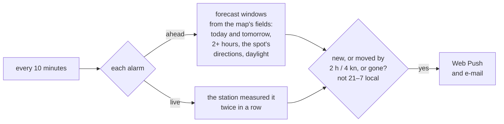

# Accounts, spots and alarms

Forecasts, the map and every station work without an account. An account keeps your spots, your
gear and your alarms.

## Signing in

Signing in works with a passkey (WebAuthn, [webauthn-rs](https://github.com/kanidm/webauthn-rs)
on the server, OpenSSL built into the binary) or with e-mail and password (Argon2id, at most
ten failed attempts per address in 15 minutes). Sign-up asks for a name and then either a
passkey or an address and a password (at least 10 characters); either can be added later on the
account page. Passkeys are made discoverable, so the browser offers them in the sign-in field
by itself. They belong to the domain of `WF_PUBLIC_URL`; changing the domain later makes them
useless, so set it before the first sign-up. A session is a random token in an HTTP-only cookie
(half a year, renewed while used; only its SHA-256 is stored).

## Spots

A spot is a saved station or point with your own name and, optionally, the **wind directions
that work there** (a sector, clockwise from one compass point to another). Up to 100 per account.
The start page shows each spot at a glance, with nothing to set: the wind measured there now
(stations), the coming days as one band in the wind scale's colours from the map's data (hours
from directions that do not work there faded) and the strongest hour. The forecast's quick view
marks the hours that work at the spot.

## My gear

Under *My gear* (`/gear`) a user enters each kite, wing, windsurf sail and parawing with
the mean wind (kn) they ride it in, or starts from a template per kind and level (rough values
for about 80 kg). The day cards then have a row with what fits each hour (the piece whose
range the wind sits in most centrally, marked when the gusts go past its top), and the spot
cards name it for the strongest hour. Signed in, the list is kept on the server; without an
account in the browser, and it moves to the account at the first sign-in.

## Alarms

Each saved spot has a bell for its alarm: from how much mean wind, optionally only hours some
piece of "Mein Material" fits, told ahead from the forecast (the best window of today and
tomorrow, at least two hours in a row, from the spot's directions, in daylight; again when it
moves by two hours or 4 kn, and when it falls through) and/or live when the station measures it
twice in a row (once a day); nothing goes out between 21 and 7 local time. The server checks
every alarm every ten minutes against the wind map's fields and the latest measurements, and
sends push messages (Web Push with its own VAPID key, `vapid.pem` in the data directory, made on
first start; keep it with the database, a new key makes every browser subscribe again) and
e-mails when `WF_SMTP_URL` and `WF_MAIL_FROM` are set. Messages are written in the user's
language, time zone and wind unit. Push works on Android and desktop browsers right away, on an
iPhone or iPad once Windfenster is added to the home screen (iOS 16.4 and later); the account
page turns it on per device and sends a test.

The server posts push messages only to the browsers' push services (Google's for Chrome, Edge,
Opera, Samsung Internet and Brave, Mozilla's for Firefox, Apple's for Safari, Microsoft's for old
Edge), follows no redirect and keeps at most ten browsers per account. Any other address is
refused: otherwise a signed-in user could make the server post into the network it runs in.

Messages are written in the user's language, time zone and wind unit. Push needs HTTPS (or
`localhost`); e-mail needs [`WF_SMTP_URL` and `WF_MAIL_FROM`](configuration.md#e-mail-for-alarms).
