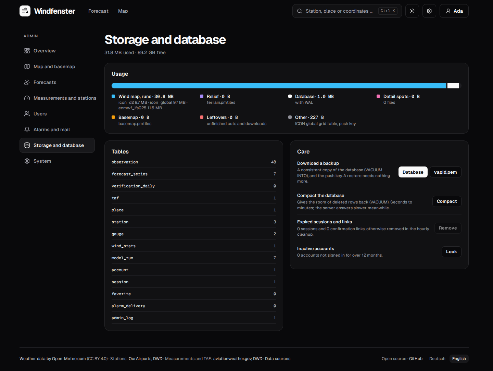

# The admin page

Under `/admin` an admin sees what the server is doing and changes it without a restart. The
page is only for accounts with the admin role; everyone else gets "only for admins". An admin
reaches it by the gear in the header, on a phone by the link on the account page.



## The first admin

Nobody can make themselves an admin over the web, not even the first account. On the server:

```bash
windfenster admin tristan@example.org      # by e-mail address, by name, or by #id
windfenster admin --list                   # who is admin
windfenster admin --remove tristan@example.org
```

In the container: `docker compose exec windfenster windfenster admin tristan@example.org`
(Podman: `podman exec windfenster windfenster admin …`). The account must exist: sign up first.
Once there is an admin, they can make more on the admin page. The last admin who may sign in
keeps the role: it cannot be taken, and the account cannot be disabled or deleted.

Every change an admin makes is written to the admin log (who, when, what), kept a year.

## Settings: the environment wins

Many settings can be changed on the admin page and take effect without a restart: the models in
use, the Open-Meteo budget, how long places are kept current, the limits per visitor, the tracked
stations, the basemap's mode and depth, ICON global, the e-mails a day, sign-up, a notice for
visitors, legal notice and privacy policy. A value comes from, in this order:

1. an environment variable that is **set** (in `compose.yaml`, the Quadlet unit or `.env`): the page
   shows it with a lock and the variable's name, and cannot change it;
2. what the admin page stored (table `setting`);
3. the default.

So an existing setup keeps working as it is; to manage a value on the page, remove its variable
and restart once. The address (`WF_PUBLIC_URL`), the data folder, SMTP and the Open-Meteo key stay
in the environment: the server needs them before the database, and secrets do not belong on a web
page.

## Overview

What needs a decision comes first: a missing or plain-http `WF_PUBLIC_URL`, requests without the
client-address header (`WF_CLIENT_IP_HEADER`; without a proxy in front that sets it, anyone can
set it and pass the limits per visitor), a task whose last run failed, a source that failed three
times or more in a day, a loop that crashed and was started again, an Open-Meteo budget used to
80 %, less than 2 GB free. Then the day's numbers: Open-Meteo calls against the budget, the data
folder on the disk, accounts, alarm messages.

Every background task with how often it runs, when it last ran, how long it took and what came of
it (with the error as the log has it), and a button that runs it now:

| Task | Every | |
|---|---|---|
| New model runs, refresh places | 5 min | Open-Meteo |
| METAR, water gauges | 9 min | aviationweather.gov, PEGELONLINE |
| TAF, DWD 10-minute values | 29 min | aviationweather.gov, DWD |
| Cleanup and verification | hourly | the database |
| Station lists | weekly (checked hourly; "now" fetches them whatever their age) | OurAirports, aviationweather.gov, DWD |
| Wind map ICON-D2 and ECMWF, ICON global | 10 min | DWD, ECMWF (its Google Cloud copy when busy) |
| Basemap and relief | daily | Protomaps, Mapterhorn |
| Detail spots | 1 min | Protomaps |
| Alarms | 10 min | push services, SMTP |

Each outside source shows when it last answered and how often it failed in the last 24 hours.
The state lives in memory and fills again within a round after a restart.

## Map and basemap

**Basemap**: which Protomaps build it is, when it was made, when it will be renewed for its age
(120 days), its depth. The renewal has three modes:

- **Automatic** (the default, `WF_BASEMAP=auto`): when due (old, missing, or the depth changed) the
  server makes it at once;
- **Ask** (`WF_BASEMAP=ask`): when due, the page says so with the newest build and waits:
  "Get it now" starts it, "Later" puts it off for 30 days;
- **Never** (`WF_BASEMAP=off`): the files are left as they are, the relief and the spots too.

The relief (yearly) follows the same mode. A cut or a download under way shows how far it is,
how fast and how long it still takes, and can be cancelled: the old map stays in use, a cut starts
over next time, a download goes on from its pieces. The depth (world zoom, region, region zoom,
relief zoom, spots) can be changed here; a change makes the file anew (in the mode "ask" after
asking).

**Detail spots**: each with why it is there (kept, a tracked station or an opened place, tapped on
the map, no longer wanted), its size and when it was last wanted. "Keep" pins a spot so it stays
whoever looks there; "Delete" removes its file (it comes again if someone opens the place).
"Clear leftovers" removes what a restart left behind.

**Model fields**: the wind map's runs on disk per model; ICON global can be turned off (its runs
go, about 3 GB) and on.

## Forecasts

How often forecasts update (by model run, not by the clock), the Open-Meteo budget of today with
the calls of the last 14 days (refreshing after new runs against newly opened places, and the
limit for new places), each model with its newest run, the places that have it, and whether its
time was estimated; models can be turned off and on. The settings: how long places are kept
current (7 days), when unopened points are dropped (2 days), the daily budget, and the limits per
visitor (30 new places an hour, 100 a day, 300 searches an hour). Below, the places kept current,
tracked stations first.

## Measurements and stations

The station lists with when they were last imported ("Import now" fetches them whatever their
age), the tracked stations (added and removed here; a slug that names no station is flagged), what
came in during the last hour (METAR, DWD), the TAFs valid now, the gauges with a fresh level, the
ten-year wind statistics with those running or failed lately ("Now" tries again), and the newest
verified day ("Run now" runs the hourly cleanup and verification).

## Users

**Sign-up** is open (anyone makes an account), by invitation or closed. By invitation, an admin
makes a link (`/login?invite=…`, shown once, valid 14 days, used once) and sends it on; the
invitations of the last 30 days show who used them, open ones can be withdrawn. Closed, the
sign-in page says so; existing accounts sign in as before.

The list of accounts with how each signs in (passkey, password), when it was last seen (to the
day), its spots and alarms, and its role. Picking one shows its sessions, push devices, gear and
the alarms delivered to it in the last 30 days. An admin can

- send the confirmation mail again,
- sign the account out everywhere,
- download the account's data as JSON (for its owner: GDPR); it holds no password hash and no
  passkey keys,
- make it an admin or take the role,
- disable it: no sign-in, its sessions end, its alarms rest, its data stays; or enable it again,
- delete it with everything it holds.

Nobody sees passwords, admins neither.

## Alarms and mail

The alarms there are and the day's messages (delivered by push, by e-mail, not delivered), the
SMTP server (never its password) with the sender, today's mails against the limit (500 a day by
default, all mails together: confirmations, alarms, tests; beyond it alarms go by push only), a test
mail to any address, the push key's age and the browsers by push service, and every message handed
to a channel in the last 30 days with what came of it (`push 410`, `e-mail: limit` ...).

A new push key: delete `vapid.pem` in the data folder and restart; every browser has to subscribe
again (the account page offers it).

## Storage and database

The data folder by part (the wind map's runs per model, relief, database, detail spots, basemap,
leftovers, the rest) with what is free, the rows per table, and:

- **Backup**: the database as a consistent copy (`VACUUM INTO`, made beside it, sent and removed),
  and the push key `vapid.pem`. A restore needs nothing more.
- **Compact** the database (`VACUUM`): gives the room of deleted rows back; the server answers
  slower meanwhile.
- **Expired sessions and links**: removed now instead of in the hourly cleanup.
- **Inactive accounts**: how many were not seen for over a year (the users section lists them).

## System

The version and whether a newer one is out (the server asks GitHub for the newest release once a
day; nothing is installed by itself), the environment variables (secrets only as "set"), the
in-memory caches with their entries and a button that empties them, and what visitors see of the
operator: a **notice** above every page, the **legal notice** and the **privacy policy** (plain text,
paragraphs separated by a blank line; linked at the foot of every page, at `/imprint` and
`/privacy`). The overview warns when a public instance (https) with accounts has neither.

The log shows the server's last 500 warnings and errors since the start, and the admin actions of
the last year.
