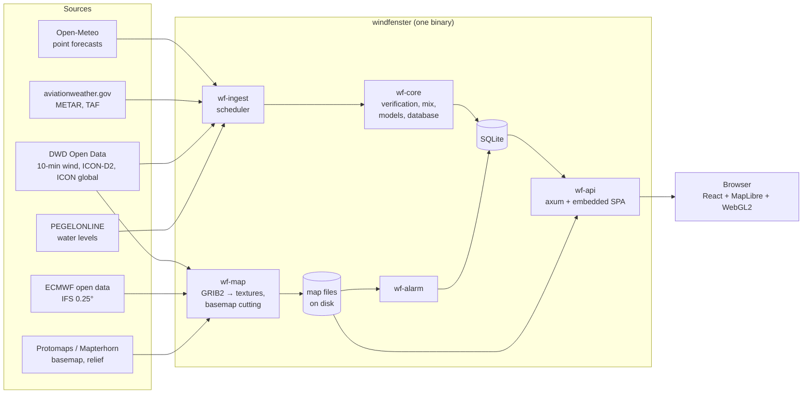

# Architecture

Windfenster is **one Rust binary** that serves an API and a React single-page app built into it,
keeps an SQLite database and runs background loops that fetch forecasts, measurements and the
map's model fields. The browser does the drawing, including the wind map in WebGL2.

## The crates

| Crate | What it does |
|---|---|
| `wf-core` | The domain without input or output of its own: models, units, stations and places on the 0.01° grid, forecast series, measurements, the TAF's hourly series, gauges, verification and the mix, accounts, favourites, gear, alarm rules, the database queries. |
| `wf-ingest` | Fetching: Open-Meteo forecasts and place search, station lists (OurAirports, aviationweather.gov, DWD), measurements (METAR, DWD 10-minute values), TAFs, PEGELONLINE, the archives for the wind statistics; and the **scheduler** that runs it all. |
| `wf-map` | The wind map's data: GRIB2 from the DWD (ICON-D2, ICON global) and ECMWF decoded into PNG textures and raw texels, runs kept on disk; cutting the basemap and relief from Protomaps and Mapterhorn. |
| `wf-alarm` | Alarms: forecast windows from the map's fields, live checks from the measurements, Web Push and e-mail. |
| `wf-api` | The HTTP side ([axum](https://github.com/tokio-rs/axum)): JSON API, response caches, the map's files and tiles, station pages with meta tags for search engines, the embedded SPA. |
| `windfenster` | The binary: `serve`, `migrate`, `import-stations`, `probe`; reads the configuration and starts the loops. |

## The web app

`web/` is a React app built with Vite: [TanStack Router](https://tanstack.com/router) (file-based
routes in `src/routes`) and [TanStack Query](https://tanstack.com/query) for the API, Tailwind CSS
v4 with shadcn/ui components, [Paraglide JS](https://inlang.com/m/gerre34r/library-inlang-paraglideJs)
for German and English, [MapLibre GL JS](https://maplibre.org/) for the map and own WebGL2 code
for the wind.

| Folder | |
|---|---|
| `src/routes/` | pages: start, station, point, map, gear, account, sign-in, sources, admin |
| `src/components/forecast/` | the ten days: quick view, day cards, model chips |
| `src/components/map/` | the map: colour field, particles, pins, timeline, spot card |
| `src/components/live/`, `verification/` | live tile, history and statistics; comparison chart, ranking, agreement |
| `src/lib/` | logic without UI, each with Vitest tests: forecast days, model choice, agreement, METAR decoder, TAF texts, units, wind map maths |
| `src/bindings/` | the API's types, generated from Rust by [ts-rs](https://github.com/Aleph-Alpha/ts-rs) |
| `messages/` | every text, `de.json` and `en.json` |

The API never sends prose: errors and notices are codes (`ErrorCode`, `Notice`), and the app maps
each to a text in the viewer's language. A missing mapping fails the type check.

## Shared types

API types are Rust structs that derive `ts_rs::TS`. `cargo test` writes them to
`web/src/bindings`, and the app imports them from there, so a field renamed on the server breaks
the app's type check, not its users. CI fails when the committed bindings are out of date.

## The database

SQLite through [sqlx](https://github.com/launchbadge/sqlx), migrations in `migrations/` (applied on
start; a pushed migration is never changed, sqlx checks their checksums).

| Tables | Hold |
|---|---|
| `station`, `place`, `model`, `model_run` | stations (METAR, DWD), places on the 0.01° grid, the models and their runs |
| `forecast_series` | one row per place, model and run: hourly wind, gusts, direction, weather |
| `observation`, `taf` | measurements and airport forecasts, 13 months at watched stations |
| `gauge` | water levels, the newest per gauge |
| `verification_daily` | each model's errors per station, UTC day and lead time |
| `wind_stats` | the ten-year summary per station |
| `account`, `passkey`, `session` | accounts, WebAuthn credentials, sessions (only the token's hash) |
| `favorite`, `gear`, `alarm`, `push_subscription`, `alarm_sent` | spots, gear, alarms and what was sent |
| `setting`, `admin_log`, `invite`, `alarm_delivery`, `usage_daily` | the admin page: settings changed there, what admins did, invitations, every alarm message handed to a channel, counters per day (Open-Meteo calls, e-mails) |

The wind map's fields are **files**, not rows: `{WF_DATA_DIR}/map/{model}/{run}/{step}.png`, `.rgba`
and `.json`, plus the basemap and relief as PMTiles. See [The wind map](wind-map.md).

## Places and units

- **Places**: every forecast is stored per point on the 0.01° grid (`wf_core::geo::GridPoint`);
  a station uses the grid point of its coordinates, so a station and a click next to it share one
  forecast.
- **Units**: the server stores and sends wind in **knots**; the app converts to m/s or km/h.

## The background loops

`windfenster serve` starts them next to the HTTP server (`WF_SCHEDULER=false` turns them off):

| Every | What |
|---|---|
| 5 min | new model runs on Open-Meteo; refresh the places opened within 7 days |
| 10 min | all METARs (one file), all PEGELONLINE gauges; the map's models (ICON-D2, ECMWF; ICON global in its own loop); the alarms |
| 30 min | TAFs; DWD 10-minute values for watched stations |
| hourly | verification of every model at every station with measurements |
| daily | the basemap and relief: rebuilt when old or when their settings changed |
| a minute | detail basemap spots around places people look at, two at a time |
| weekly | the station lists |

Settings the admin page changes live in `wf_core::admin::settings`: the loops and the API read the
current ones each time they need a value (an environment variable that is set wins over a stored
one, which wins over the default), so a change takes effect without a restart.

Every loop reports each run (when, how long, what came of it) and each outside source's answers to
a status board in memory (`wf_core::status`), which the admin page reads; the log's warnings and
errors go there too, the last 500. The admin page can ask a task to run now: its loop wakes.

Each step of the scheduler has a time limit (2 minutes for one file like the METARs, 5 for the
per-station fetches, 10 for the forecast refresh): a source that hangs is given up and tried
again next turn, so it cannot hold up the others. Every loop runs under a supervisor that
starts it again a minute after a panic.

Details per source: [Forecasts and models](forecasts.md), [Measurements](measurements.md),
[The wind map](wind-map.md), [The basemap](basemap.md), [Accounts and alarms](accounts.md).

## Pages for search engines

The app renders in the browser, but `/station/{slug}` is served by the server with the station's
title, description, Open Graph tags and JSON-LD filled into `index.html` (`wf-api/src/meta.rs`),
so a link preview and a search result show the station's name and region.

## Caches

The server keeps hot answers in memory ([moka](https://github.com/moka-rs/moka)): assembled
forecasts per place, place search results, rankings, the map's pins and the pieces of ICON
global. The map's textures are sent with an immutable cache header: a run's hour never changes.

The web app is compressed once, when it is built (`web/scripts/precompress.mjs`): every text
file gets a Brotli and a gzip copy at the highest level (9.4 MB → 1.5 MB with Brotli), and the
server sends the copy the browser accepts as it is. Compressing it per new visitor took about
half a second of CPU on a desktop, several on a Raspberry Pi. Browsers ask for Brotli over
HTTPS only; over plain `http://` they get gzip.
