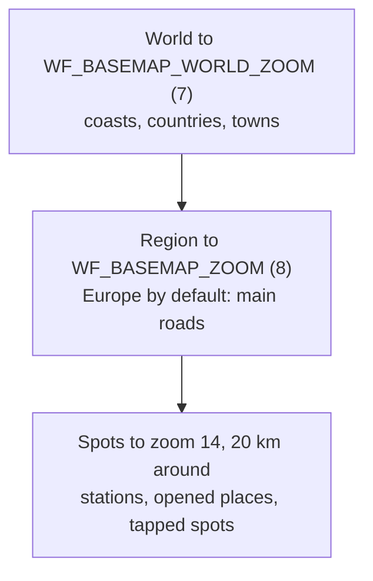

# The basemap and relief

Land, water, roads, towns and names under the wind come from **OpenStreetMap**, as vector tiles
from [Protomaps](https://protomaps.com/), drawn in Windfenster's own style (light and dark, names
in the viewer's language). The hill shading comes from [Mapterhorn](https://mapterhorn.com/). The
server cuts both itself and serves every tile; there is no map service and no API key.

## Three layers of detail



A **higher zoom is more detailed**: zoom 0 is the whole world on one tile, 7–8 shows countries and
main roads, 10–12 streets, forests and small lakes, 14 every path, building and slipway. Every
level splits each tile into four, so each costs three to four times the one before.

| Setting | Default | Covers | Size |
|---|---|---|---|
| `WF_BASEMAP_WORLD_ZOOM` | 7 | the whole world | 6: 45 MB · 7: about 150 MB |
| `WF_BASEMAP_REGION` | `-25,27,45,72` (Europe) | the deeper region, `west,south,east,north` | – |
| `WF_BASEMAP_ZOOM` | 8 | the region | Europe 8: about 190 MB · 12: about 7 GB · the Upper Rhine to 15: about 210 MB |
| `WF_BASEMAP_SPOTS` | 60 | detail areas kept | 2 to 17 MB each |
| `WF_TERRAIN_ZOOM` | 7 | relief, the whole world | 6: 278 MB · 7: 948 MB |

## How it is made

Towns, roads and lakes from close up come from [Protomaps](https://protomaps.com/), vector
tiles of OpenStreetMap, drawn in Windfenster's own style, light and dark, with names in the
viewer's language. Without them the map shows the world from
[Natural Earth](https://www.naturalearthdata.com/) (Europe finer).

By default (`WF_BASEMAP=auto`) the server makes the basemap itself, a minute after the start and
then checked daily: from Protomaps' newest daily build it takes, by byte range, the whole world
up to zoom 7 (coasts, countries, towns) and a region deeper, Europe up to zoom 8 by default
(main roads), into one file (together 323 MB, 24,752 tiles, about 13 minutes on 11 October),
`{WF_DATA_DIR}/map/basemap.pmtiles`. A note next to it (`basemap.json`) says what it was made
from; it is made again after 120 days, or when the settings change.

Detail (streets, lakes, beaches, up to zoom 14) comes where people look, anywhere in the world:
around each tracked station (`WF_TRACKED_STATIONS`), each place opened in the last week and each
spot tapped on the map, the server cuts 20 km from the newest build into a file of its own,
`{WF_DATA_DIR}/map/basemap-spots/{lat}_{lon}.pmtiles` (2 to 17 MB; spots are snapped to a 0.2°
grid, so places close together share one). It checks every minute and makes two at a time, so a
tapped spot has its detail within a minute or two, and the open map shows it without reloading.
At most 60 spots are kept (about 600 MB), a hard limit: when more are wanted, tracked stations come
first, then the places opened most recently, then the latest taps (the server remembers 200
taps); spots nobody wants any more go first.

The map gets every tile from the server, at `/api/map/basemap/{z}/{x}/{y}`: from the spot that
holds it, else from the main file, and where neither goes that deep, cut out of the deepest tile
above it (scaled and clipped, as MapLibre does past a source's last zoom). So the map is one
source with no seams and never blank; it is only coarser where nobody looked yet. With room to
spare, set `WF_BASEMAP_WORLD_ZOOM` and `WF_BASEMAP_ZOOM` higher (the region with
`WF_BASEMAP_REGION`), and `WF_TERRAIN_ZOOM` for finer relief.

Relief comes from [Mapterhorn](https://mapterhorn.com/) (elevation from national surveys and
other open data, [sources](https://mapterhorn.com/attribution)): the server cuts the whole world
to zoom 7 from its planet archive into `{WF_DATA_DIR}/map/terrain.pmtiles` (948 MB, 13,522 tiles, about 7 minutes on 11 October; renewed
yearly, served at `/api/map/terrain.pmtiles`), and the map draws it as hillshade over the colour
field and under water, roads and labels, softer from town zoom on.

A file you put there yourself (no note next to it) is never replaced. To cover more, cut one
with the [pmtiles CLI](https://docs.protomaps.com/pmtiles/cli) (or its Docker image
`protomaps/go-pmtiles`):

```bash
pmtiles extract https://build.protomaps.com/20261010.pmtiles data/map/basemap.pmtiles \
  --bbox=-25,27,45,72 --maxzoom=12
```

Europe to zoom 12 is about 7 GB; the Upper Rhine to zoom 15 about 210 MB. `WF_BASEMAP=off`
leaves the file to you; the server cuts its tiles the same way where it stops.
OpenStreetMap is credited on the map.

## Changing the depth

Change the variable and restart. A minute after the start the server compares the settings with
the note next to the file (`basemap.json`, `terrain.json`); when they differ it makes the file
anew from the newest build:

- it **downloads the whole file again** (no tiles are reused from the old one);
- it writes to `basemap.pmtiles.part` and swaps it in only when complete, so **the old map stays
  in use** meanwhile, and you need room for both;
- each range that fails for a moment (a 5xx, 429 or cut connection, which Protomaps and Mapterhorn
  answer now and then over hours of requests) is asked again up to nine times, the wait doubling from 1 s to a
  minute (about five minutes in all); only when it keeps failing does the cut stop. A restart in the middle **starts over**; after an
  error it tries again in an hour;
- the tiles are walked one at a time in the archive's order, only the source's directories in
  use are kept (64 MB at most), and the new archive is written as it goes: tile data straight
  into the file, a leaf directory every few thousand entries into a side file, the root and
  header at the end. Memory stays flat however large the cut (50 million tiles in under 30 MB);
  only time grows, and the log says every five minutes how many tiles are done and how long
  is left;
- before a cut it checks that the disk has room for it (the source's size times the share of
  its tiles asked for) and does not begin without;
- the detail spots stay as they are; from `WF_BASEMAP_ZOOM=14` none are made inside the region,
  and spot files the main file now holds as deep are removed.

Reload the map page in the browser afterwards.

## The whole world at full depth

When the cut asked for is all of the source, the server does not cut it tile by tile but
downloads the source file as it is:

| Setting | Source file | Size | At 35 to 60 MB/s |
|---|---|---|---|
| `WF_BASEMAP_REGION=-180,-85.05,180,85.05` with `WF_BASEMAP_ZOOM=15` | Protomaps' daily build | about 139 GB | about 40 min |
| `WF_TERRAIN_ZOOM=12` | Mapterhorn's `planet.pmtiles` | about 356 GB | about 2.5 h |

Cut tile by tile, the same world would take days (one request per tile, a few hundred tiles a
second). The download:

- fetches pieces of 512 MiB one after the other, each its own range request on a connection
  of its own, written at its place in `basemap.pmtiles.part`. Both sources sit behind
  Cloudflare, where one long connection was seen to stop sending after some 12 GB while a new
  one went on at full speed: a request that brings less than 1 MB/s for 20 s is dropped and
  its piece asked again from where it got. A piece counts only when it is complete;
- retries a moment's failure (5xx, 429, a cut or hung connection) without end, waiting 5 to
  60 s; only 30 minutes without a single piece done end the round, and the next round an hour
  later goes on from the pieces there;
- goes on after a restart with the pieces still missing: the source, its ETag, its length and
  the pieces done are kept in `basemap.pmtiles.part.json`, and the last MiB before them is
  first fetched again and compared with the part. If the source changed (another ETag, a 200
  instead of 206, bytes that differ), it starts over. The build is chosen once and kept for
  the whole download; only if Protomaps deletes it meanwhile does it switch to the newest;
- checks the room on the disk first and does not begin without it (the log says how much is
  needed and free), and checks the file's length and PMTiles header before it swaps it in;
- says every five minutes how far it is, how fast and how long it will take.

With the world at zoom 15 in the main file no detail spots are made any more.

!!! tip "Full detail where you ride"
    A small region very deep costs little: `WF_BASEMAP_REGION=7.5,47.5,9.0,49.5` with
    `WF_BASEMAP_ZOOM=15` covers the Upper Rhine with every street and building in about 210 MB.
