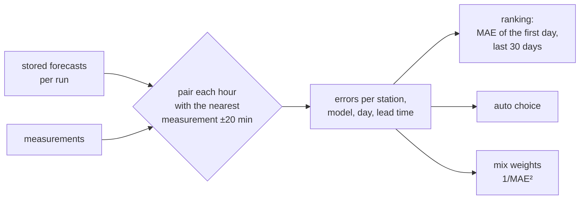

# Forecasts and models

A station or point page shows up to seven weather models side by side and opens with the one that
was closest to the measurements there. This page explains where the numbers come from and how
"closest" is decided.

## The models

| Model | By | Resolution | Ahead | Runs a day | Class |
|---|---|---|---|---|---|
| ICON-D2 | DWD | 2.2 km | 48 h | 8 | Superforecast (Germany and the Alps) |
| AROME | Météo-France | 1.5 km | 42 h | 8 | Superforecast (France and around) |
| HARMONIE | DMI | 2 km | 60 h | 8 | Superforecast (Europe) |
| ICON-2I | ItaliaMeteo | 2.2 km | 72 h | 2 | Superforecast (Italy and around: Lake Garda, Sardinia, Sicily, the Adriatic) |
| ECMWF IFS | ECMWF | 25 km | 15 days | 4 | Forecast (world) |
| ICON-EU | DWD | 7 km | 5 days | 8 | Forecast (Europe, the Mediterranean, North Africa) |
| GFS | NOAA | 13 km | 16 days | 4 | Forecast (world) |

A regional model shows only where its domain covers the place. ICON-EU is regional too, but at 7 km
no Superforecast model (those are 3 km or finer): it counts with the global ones and is the finest
model where the others stop, around the whole Mediterranean (Rhodes, Greece, Spain's south). Since
it ends after five days, Forecast never picks it to fill the ten. `WF_MODELS` limits the list, or
the switches on the [admin page](admin.md#forecasts) when the variable is not set.

## How forecasts are fetched

Requests go to [Open-Meteo](https://open-meteo.com/) only from the server, never from the
browser. A place (a station, or a point rounded to the 0.01° grid) is fetched **when someone opens
it, once per model run**: Open-Meteo's model metadata says when a new run is out, and a place is
asked again only then. Places opened within the last seven days are refreshed after every new
run; points nobody opened for two days are dropped. A model that answers a place without values (a
regional model's rectangle reaches past its domain) is asked there again a day later, not with
every run.

The free API allows about 10,000 calls a day (`WF_OPEN_METEO_DAILY_BUDGET`, 9,000 by default):
enough for a few hundred places people look at regularly. Opening new places may use two thirds
of it, at most 30 an hour and 100 a day per client; the rest stays for the refreshes
([limits](configuration.md#open-meteo-free-or-with-a-key)). The calls are counted per UTC day in
the database, so a restart does not reset them; the admin page shows the day and the last 14, and
changes the seven and two days, the budget and the limits without a restart.
`windfenster probe --lat … --lon …` prints what Open-Meteo returns for every model at a place.

## The ten days

The page builds the ten days from the selected model and fills what it does not reach from the
global one:

- **Today and tomorrow**: hourly from 7 to 19 when a fine regional model is selected (ICON-D2,
  ICON-2I, AROME, HARMONIE), every 3 hours with a global one or the mix.
- **Days 3 to 7**: every 3 hours around the clock, 8 columns.
- **Days 8 to 10**: the same columns, marked *Trend*.

The **quick view** takes the same days every 3 hours: the bars, the main direction over the
daytime (the mean of the wind vectors, so a strong hour counts more than a calm one and north
stays north across 360°), and the strongest daytime wind.

## Verification and ranking

Every hour Windfenster compares, for each station with measurements, every stored forecast hour
with the measurement closest to it (within 20 minutes):

- the **mean wind**: absolute error and bias in kn;
- the **direction**: the angle between them, from 5 kn measured on;
- **"14 kn or more"**: whether both said so.

A run counts only for the hours after Windfenster fetched it, so a model that arrives late gains
nothing from hours that had passed. Errors are kept per station, model and UTC day, split by lead
time: 0–24, 24–48 and 48–72 hours after the run. The [TAF](measurements.md#taf) counts as a model
of its own, from its issue time.

- **Who hits here?**: the mean absolute error of the first day ahead over the last 30 days. A
  point takes the ranking of a station at most 5 km away.
- **Auto choice**: from 14 days of data the page opens with the regional model of the lowest error
  for 0–24 h, and *Forecast* takes the global model of the lowest error for 48–72 h among those
  that reach the ten days. Before that a fixed order decides (ICON-D2, ICON-2I, AROME, HARMONIE,
  then ECMWF IFS, ICON-EU, GFS; for the ten days ECMWF IFS, then GFS). A saved spot can name its
  own starting model instead (the spot's dialog, *Starting model*); where that model has no values,
  the auto choice holds.

## The Windfenster mix

Per hour the weighted mean of every model with a value there, each weighted by **1/MAE²** of that
model at the station for that lead time (all alike before 14 days); the direction is that of the
mean wind vector. The mix is computed when a page is served and verified like a model, as it stood
each time new runs came in. It opens the page only where it beat the best single model.

## Do the models agree?

The **spread** (highest minus lowest mean wind) of the models at the windiest daytime hour:

| Spread | Agreement |
|---|---|
| up to 4 kn | high |
| up to 8 kn | medium |
| more | low |

The tile shows it for the next two days with every model on a strip; each day card and each
quick-view tile show it for their day.
