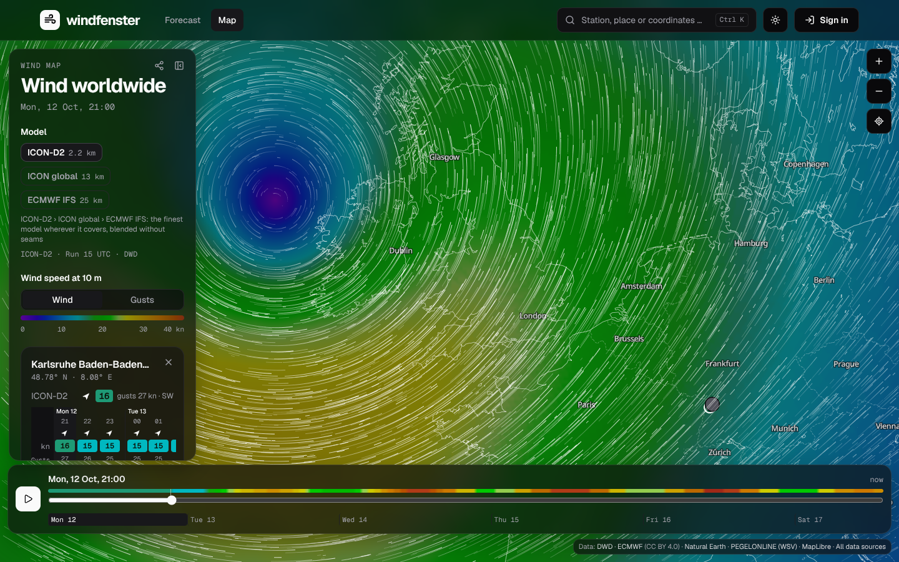

# Windfenster: open-source wind forecast and wind map for water sports

**Windfenster shows, for every wind station, what it measures right now, what the weather models
predict for the next ten days, and which model was closest to the measurements there.** It has
an animated wind map with three models blended into one picture, alarms when your spot works, and
it runs as one Docker container on your own server.

## What it does

- :material-weather-windy: **[Forecast per station](user-guide.md#station-and-point-pages)**:
  the ten days at a glance, then every day as a card: wind as a bar that grows, the gust right
  under it, direction, weather; hourly for today and tomorrow.
- :material-chart-line: **[Which model hits here?](forecasts.md#verification-and-ranking)**:
  every model is checked against the station's measurements every hour; the page opens with the
  one that was closest there in the last 30 days.
- :material-map: **[Wind map](wind-map.md)**: ICON-D2 (2.2 km), ICON global (13 km) and ECMWF
  (25 km) as one seamless colour field with particles, worldwide, ten days ahead.
- :material-airplane: **[Measured and TAF](measurements.md)**: every METAR airport in the world
  and the DWD's 10-minute stations, with the airport forecast (TAF) in plain words.
- :material-waves: **[Water levels](measurements.md#water-gauges-pegelonline)**: PEGELONLINE gauges
  on German rivers, with the estimated current on the Rhine.
- :material-bell-ring: **[Spots and alarms](accounts.md)**: save a spot with the wind directions
  that work there, enter your kites and wings, get a push or an e-mail when it works.

## Where to start

| You want to | Read |
|---|---|
| use Windfenster | [User guide](user-guide.md) |
| run your own instance | [Installation](installation.md), then [Configuration](configuration.md) |
| understand how it works | [Architecture](architecture.md), then the pages under *How it works* |
| build on it or change it | [API](api.md) and [Development](development.md) |

## In one paragraph

A Rust server ([axum](https://github.com/tokio-rs/axum), SQLite) fetches forecasts from
[Open-Meteo](https://open-meteo.com/), measurements from aviationweather.gov and the
[DWD](https://opendata.dwd.de/), water levels from PEGELONLINE, and the raw model fields (GRIB2)
for the map straight from the DWD and ECMWF. It verifies every model against the measurements,
turns the model fields into textures and cuts its own basemap from OpenStreetMap. A React app,
built into the same binary, shows it all; the map draws the wind with WebGL2 on top of
[MapLibre](https://maplibre.org/). Everything runs on your server: no map service, no API key, no
tracking.
