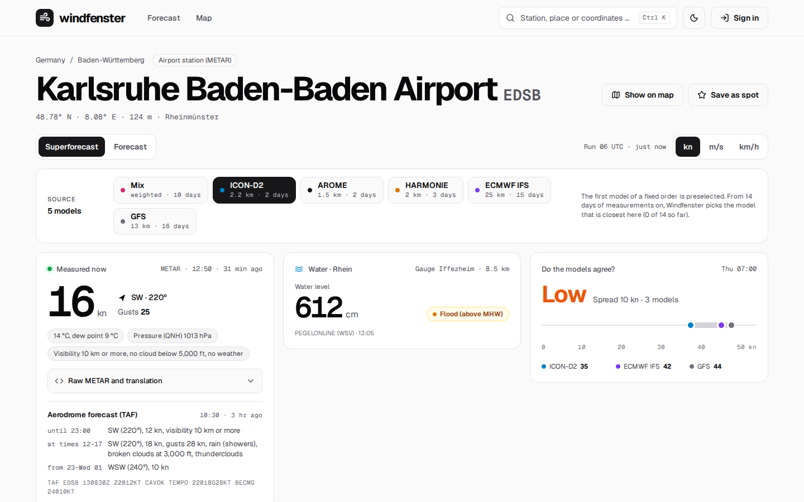
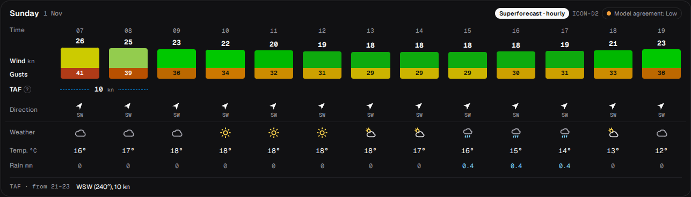
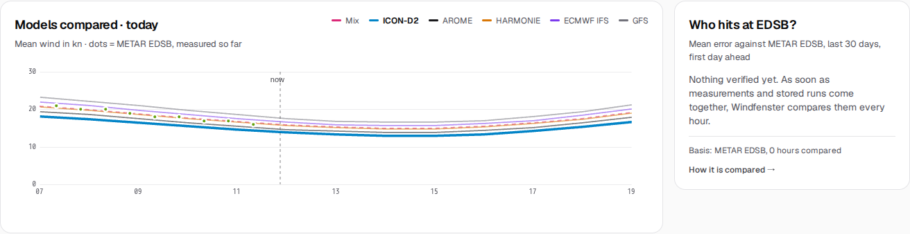
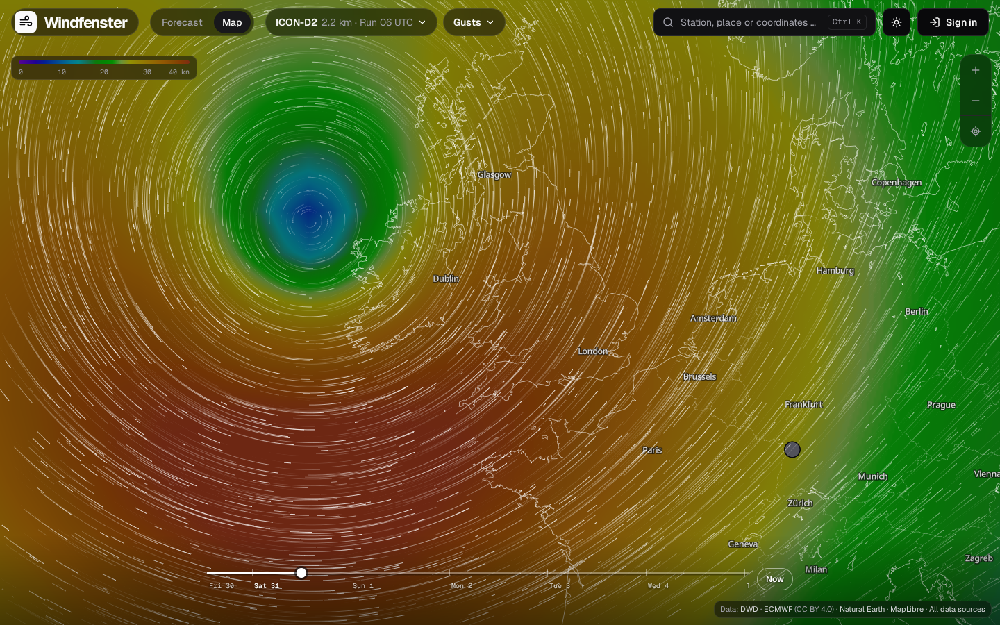
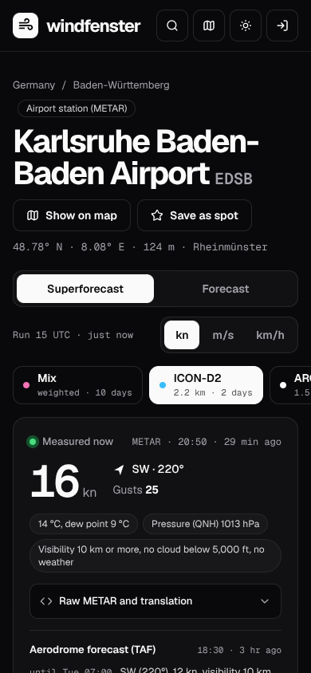
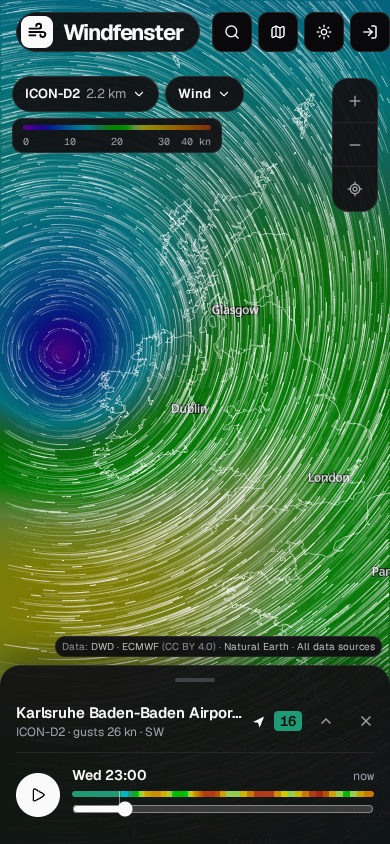

# User guide

Windfenster has three kinds of pages: a **station** (an airport with METAR reports or a DWD
wind station), a **point** (any place on earth, by map click or search) and the **wind map**.
Spots, gear and alarms come with an account.

The app speaks German and English (the switch in the footer), follows the system's light or dark
mode (the sun and moon button), and shows wind in knots, m/s or km/h (the switch beside the ten days' colour scale, kept in the
browser).

## Finding a place

The search in the header (or **Ctrl K** / **⌘K**) finds stations by name, code (EDSB, LGRP) or
town, places by name, and coordinates such as `48.78, 8.08`. A station opens its page, a place
its point page. On the map, a result flies there and opens the spot instead.

## Station and point pages

From the top:

1. **Measured now** (stations): the newest METAR or DWD value with a compass (an arrow from where
   the wind comes to where it blows, the range a METAR says it varied in, and for a saved spot its
   good directions as a green arc and whether the wind now works there), then two folds: the airport
   forecast (TAF) in plain words and the raw METAR translated group by group. Beside it **Do the
   models agree?**: the spread between the models at the windiest daytime hour of the next two
   days.
2. **Model chips**, right above the forecast, in one row: first the regional high-resolution models
   (ICON-D2, ICON-CH1, ICON-CH2, ICON-2I, AROME, HARMONIE, hour by hour), after a line the global
   ones (ECMWF, UKMO, ICON-EU, GFS, every 3 hours) and the **Windfenster mix**, a weighted mean of
   all of them. On narrower screens the chips show their names only, a line beneath says the
   resolution and reach of the one chosen, and on a phone the row swipes. The model chosen sets the
   step of the days below. Which one opens first follows the
   [ranking](forecasts.md#verification-and-ranking), or a saved spot's own starting model; the mark
   beside the count (a tick when the ranking chose) says why; the chosen model's run stands under
   the count. *Models explained* under it opens a page on what each model is good for, at the
   chosen model, with the models to look at first per area (North Sea, the Alps, Lake Garda, …).
3. **The ten-day forecast.**
4. **Measurements over the day** (stations): the last 24 hours and the ten days before, mean
   wind, gusts and direction, as a chart with the value under the pointer.
5. **Wind statistics** (stations): ten years of wind per month as a rose and the share of windy
   days; then *Water* (within 15 km of a gauge): level, flood state and, on the Rhine, the
   estimated current.
6. **Models compared · today** and **Who hits here?**: the models' wind for today against what
   was measured so far, and the ranking from the last 30 days.

### The ten days at a glance

The quick view shows all ten days in one row. Each tile has

- **eight bars**, one every three hours, as high as the wind and in its colour; the night hours
  paler; the **gust** as a tick above the bar;
- the **main direction** over the day (the mean of the wind vectors, so strong hours count more)
  as an arrow with its compass point;
- the **models' agreement** as a dot and a word (high, medium, low);
- the **strongest wind** of the daytime.

On a [saved spot](accounts.md#spots) the hours that work there are marked green under the bars,
and the whole tile turns green: daylight, from the spot's wind directions, and enough wind for
your gear (or 12 kn without gear). Tap a tile to jump to its day.

### The day cards

Every day is a card, two side by side on a wide screen. The columns are every three hours around
the clock; with a fine regional model selected, today and tomorrow are **hourly from 7 to 19**
instead. From day 8 the card says *Trend*: the models compute coarser there.

**On a phone** the days do not scroll sideways. Above them a strip shows all ten days with their
wind every 3 hours; a tap jumps to the day. Each day lists its hours under one another, as
Windfinder does: a bar behind the row as long as the wind, in the scale's colour, and a line along
its foot that runs on to the gust. On the row: time, direction, wind and gust, the TAF where it
starts (dashed, a dashed line below while it holds), the gear that fits, the weather.

The rows of a wide screen:

| Block | Rows |
|---|---|
| The forecast | **Wind** as a bar that grows with it, the number above; **Gusts** set right under it; **TAF** (for the hours to come, usually tomorrow): the airport forecast's wind, or the span its TEMPO and PROB groups allow (`12–18`), written once per section on a dashed line as long as it holds, a **?** says what it is; **Direction**; **Your gear** (signed in, or with gear entered): the piece that fits each hour. Under the table the TAF's notes for the day in words: showers, a temporary gust, a change |
| Weather | symbol (sun, clouds, rain), temperature, rain in mm |

Hours that are over stay readable, only slightly shaded, and a line marks now. What was measured
is not in the days: the tile *Measured now* at the top and the measurements further down show it.
The card's header names the model and the models' agreement for that day.

### The wind scale

The colours follow Windfinder's scale, one step per 2 knots: violet in calm, blue, cyan, teal,
green from 18 kn, yellow from 26, orange from 30, red from 38, wine and magenta from 48.

0246810121416182022242628303234363840424446485052

The map's colour field uses the same colours, 30 % darker so the particles and labels stand out.

### Models compared, and who hits here

The chart draws every model's wind for today from 7 to 19, the station's measurements as dots.
**Who hits here?** lists the models by their mean error over the first day ahead, from the last
30 days at this station; a point uses the ranking of a station within 5 km. How the ranking is
made is in [Forecasts and models](forecasts.md#verification-and-ranking).

## The wind map

Over the map lie only two pills and the scale, top left, and the timeline at the foot; on a
screen 1280 px or wider the two pills sit in the top row, beside the menu.

- **Models**: ICON-D2, ICON global and ECMWF IFS are drawn at once, the finest on top, blended
  without an edge. The model pill (with its resolution and, on a wide screen, its run) picks one;
  it and the coarser ones are drawn.
- **Wind / Gusts**: the second pill; the colour field and the particles show the mean wind or the
  gusts (key **G**).
- **Timeline**: on a wide screen a thin track straight on the map, the days under it and **Now**
  at its end; drag the knob or tap a day. The keys play (**Space**), step an hour (**←/→**, with
  **Shift** a day) and jump to now (**N**). On a phone it sits in a sheet at the foot, with play
  and the hour. The track is coloured by the wind at the picked spot.
- **Tap a place**: the spot card, under the scale on a wide screen, shows the model's wind and
  gusts there and its coming hours; tap an hour to go there. A station also shows its last
  measurement and six hours as a small curve. **Escape** closes it.
- **Stations** show their measured wind as a dot in the scale's colour, from closer up as a badge
  with an arrow; from afar they are bundled, each bundle showing the strongest wind in it.
- **Water gauges** show their level from zoom 8.5: blue normal, amber low, red high.
- **Town zoom**: from zoom 9.5 the colour field fades out and the map comes forward; the particles
  take the scale's colours instead.
- **Share**: the view, hour, layer and model stay in the address; copy it from the browser, or on
  a phone with the share button in the spot sheet.
- With a mouse, the wind under the pointer shows without a click.
- On a phone the spot is a sheet you pull up or swipe away.

With *reduce motion* set in the system, arrows that stand still take the particles' place.

## Spots, gear and alarms

Signed in (passkey, or e-mail and password) you can

- **save a spot**: the star on a station or point page, with your own name, the wind
  directions that work there and the model its forecast opens with (*Starting model*: automatic,
  the one that hits best there, or the mix or a model of your choice). The start page lists your spots with the wind measured now and the
  coming days as one band, in place of the two example stations it shows a first visit;
- enter **your gear** under *My gear*: every kite, wing, sail and parawing with the wind range you
  ride it in, or a template per kind and level. The forecast then shows what fits each hour;
- set an **alarm** per spot (the bell): from how much wind, optionally only when some of your gear
  fits, told ahead from the forecast and/or when the station measures it. By push and e-mail.

On the account page you add a passkey on each device you sign in with, name it, and remove one
you no longer use (a lost phone, a password manager given up); the last way into the account
stays. *Sign out on other devices* signs out everywhere but where you are.

Whoever runs the server decides who may sign up: everyone, only with an invitation link, or
nobody new. Details: [Accounts, spots and alarms](accounts.md).
