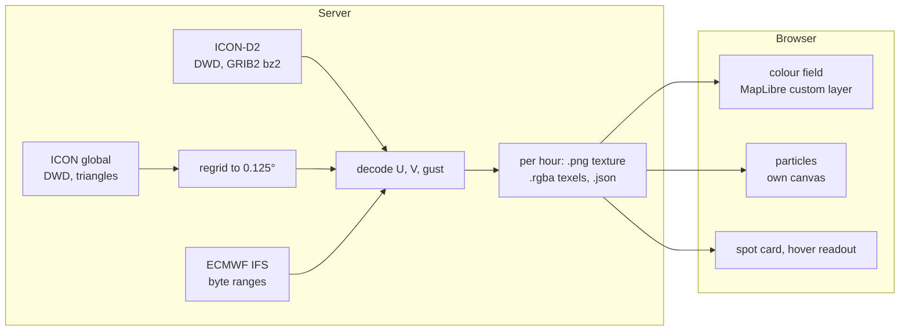
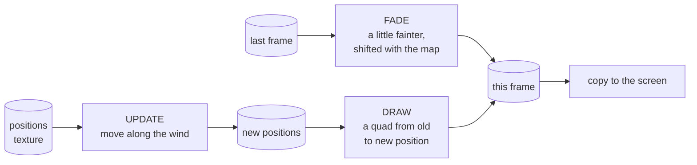

# The wind map

The map does not draw Open-Meteo's point forecasts: it draws the **models' own fields**, fetched
as GRIB2 from the weather services, turned into textures on the server and painted by the browser
with WebGL2. Three models lie on top of each other, the finest wherever it covers, blended without
an edge.

## The models on the map

| Model | Grid | Area | Ahead | Runs | Per run |
|---|---|---|---|---|---|
| **ICON-D2** (DWD) | 2.2 km, regular 0.02° (1215 × 746) | Germany, the Alps, around | 48 h, hourly | every 3 h | ~150 MB download, ~230 MB on disk |
| **ICON global** (DWD) | 13 km, triangles, put on 0.125° (2880 × 1441) | world | 78 h hourly, to 120 h 3-hourly | 00 and 12 UTC | ~1.1 GB download, ~1.5 GB on disk |
| **ECMWF IFS** | 0.25° (1440 × 721) | world | 120 h, 3-hourly | 00, 06, 12, 18 UTC | ~115 MB download, ~220 MB on disk |

Each has its own loop on the server; every 10 minutes it looks for the newest run and fetches
only the hours not on disk yet. The DWD writes a run's files one variable at a time, so an hour is
taken once its wind *and* its gust are listed (an hour whose gust is not out yet waits, unless a
later hour's gust is listed already). One bad file costs that hour, not the run: the loop goes on
with the next hour and tries again in 10 minutes. The two newest runs per model are kept; older ones are deleted.
`WF_MAP=false` turns the map off, `WF_ICON_GLOBAL=false` leaves the world to ECMWF.

### ICON-D2

From [DWD Open Data](https://opendata.dwd.de/): per hour one bz2-compressed GRIB2 file for each
of U and V at 10 m and the gust (`vmax_10m`), on a regular latitude-longitude grid. The server
decodes them with the [grib](https://crates.io/crates/grib) crate (pure Rust) after unpacking
with bzip2.

### ECMWF IFS

From [ECMWF open data](https://www.ecmwf.int/en/forecasts/datasets/open-data). A step's GRIB2
file holds every quantity; the server reads the step's **index** and fetches only the wind at
10 m and the gusts (`10fg`) **by HTTP byte range**, about 2.8 MB per step instead of the whole
file. ECMWF's packing (CCSDS) is decoded with `rust-aec`. When ECMWF's portal is busy (HTTP 429)
the server waits 20 seconds and asks again, a few times, then leaves the rest to the next round.

### ICON global: from triangles to a grid

ICON global computes on an **icosahedral grid of 2,949,120 triangles**, not on rows and columns.
A texture needs a regular grid, so the server puts it on 0.125° (2880 × 1441 points): each point
takes the value of the triangle whose centre is nearest. Finding the nearest of three million
centres for four million points would be slow every hour, so the table of nearest centres is made
once from the run's `CLAT` and `CLON` files (about 10 seconds) and kept as
`{WF_DATA_DIR}/map/icon_global-grid.u32`; every hour after that is a lookup.

A whole hour of ICON global would be a PNG of 4 to 5 MB, too much for a phone. The app asks
instead for the **piece** around what it shows:
`/api/map/icon_global/{run}/{hour}/{west}_{south}_{east}_{north}.png`, edges on whole 10°, at most
100° × 80°, 100 to 500 KB, cut from the texels and kept in memory a while. Further out than such
a piece, ECMWF draws alone.

## From GRIB2 to a texture

Each model hour becomes three files under `{WF_DATA_DIR}/map/{model}/{run}/`:

| File | Holds |
|---|---|
| `{step}.png` | the texture the browser draws: **red = U** (west→east), **green = V** (south→north), each scaled from its minimum to its maximum in knots; **blue = the gust** from 0 to its maximum; **alpha = 0** where the model has no value. Row 0 is the northern edge. |
| `{step}.json` | `TextureMeta`: model, run, step, valid time, the edges in degrees, size, the ranges of U, V and gust, and the model's **domain** as a ring of points |
| `{step}.rgba` | the same texels uncompressed, so one place can be read over every hour in milliseconds |

The encoding follows [mapbox/webgl-wind](https://github.com/mapbox/webgl-wind): a byte per
component is coarse (80 kn over 255 steps is about 0.3 kn), but plenty for the eye, and a PNG
of a whole continent stays small. Hours without gusts (ECMWF's first step) have `gustMax: null`;
the map then shows the wind on the gust layer, with a note.

### The API

| Endpoint | Gives |
|---|---|
| `GET /api/map` | every hour on offer, each from the newest run that has it, per model with its area and whether it comes in pieces; the basemap's and relief's extent |
| `GET /api/map/{model}/{run}/{step}.png` and `.json` | one hour's texture and its meta (immutable, cached for good) |
| `GET /api/map/icon_global/{run}/{step}/{w}_{s}_{e}_{n}.png` | a piece of ICON global |
| `GET /api/map/series?lat=&lon=` | wind, gusts and direction at a place over every hour, finest model first (the spot card) |
| `GET /api/map/stations`, `/api/map/gauges` | the pins: stations with their latest measurement, gauges with their level |

`/api/map/series` reads the `.rgba` files: about 35 ms for a place over 90 hours, with the same
bilinear mean of the four neighbouring points as the map draws.

## In the browser

The map is [MapLibre GL JS](https://maplibre.org/) with the [basemap](basemap.md) in an own style.
The wind is two pieces of own WebGL2 code (`web/src/components/map/`):

### The colour field

A MapLibre **custom layer** under coastlines, water, roads and labels (`wind-field.ts`). Its
fragment shader, for every pixel of the screen:

1. turns the pixel back into longitude and latitude (Web Mercator);
2. reads U and V from each model's texture, at the hour before and the hour after the time shown,
   and blends the two hours by the minutes between them;
3. blends the models: **ICON-D2** wherever it covers, fading over the last 30–60 km to its edge
   into **ICON global**, which fades over the outer 4 % of its piece into **ECMWF**; each model
   ends with its last hour;
4. takes the speed (or the gust) and looks its colour up in a ramp texture: the
   [wind scale](user-guide.md#the-wind-scale), 30 % darker so particles and labels stand out;
5. fades out between zoom 9.5 and 11.5 (*town zoom*), where the map comes forward.

It draws only when the map moves or the hour changes. Textures wrap at 180° (`REPEAT`), and world
copies are drawn east and west, so the date line has no seam.

### The particles

The moving lines are after [mapbox/webgl-wind](https://github.com/mapbox/webgl-wind) (ISC), with
changes for a map you pan and zoom. They live on a **canvas of their own** over the map, so the
map does not redraw 60 times a second. Every frame runs three passes on the GPU
(`particles.ts`, `particle-passes.ts`, `shaders.ts`):

- **Positions in a texture.** Each particle is one texel: its place **relative to the visible map**
  (0…1 from the top left), two bytes per axis (red and blue for x, green and alpha for y). Being
  relative to the view keeps them equally dense at every zoom.
- **UPDATE** moves every particle along the wind of the hour shown. The speed on screen follows a
  *pace curve*: as the wind from about 5 kn up, a little faster below
  (`max(kn, 2.2·√kn)`), so light air still flows in long lines instead of crawling; below 1 kn it
  eases to a stop, so the texture's rounding never makes calm air drift. Particles outside the
  view or the models' area, and a few at random, start anew elsewhere, from an integer hash (PCG)
  so new particles never gather in patterns.
- **Panning and zooming.** When the map moves, the shader gets the shift (`u_shift`) and moves
  every particle and the trails with the map, so nothing flickers or is wiped. After a zoom out the
  old view covers only part of the new one: as many of its particles as it now holds too many
  start anew, and new ones go to the border the zoom added, so the view is evenly filled again.
  The particles a pan moves out of the view are placed straight into the strip it uncovers
  (picked by area among the up to four rectangles around the old view), so even a thin strip
  after a small pan is filled at once.
- **DRAW** paints each particle as a thin quad from where it was to where it is, with a soft pixel
  at either side (smooth slanted lines, no stair steps). A particle that just started, or stands in
  calm air, draws nothing, so there are no specks. Over the colour field the lines are white; at
  town zoom they take the wind scale's colours, so the wind's strength stays readable over the
  street map.
- **FADE** draws the last frame again a little fainter (98 % per frame at 60 frames a second,
  adjusted to the real frame time), shifted with the map. That leaves the **trails**. The loop
  takes at most about 60 steps a second: the fade rounds to whole bytes every step, so at 144 Hz
  trails would be half as long, and the GPU would do more than twice the work. Without wind the
  canvas is cleared once and the loop draws nothing.

The number of particles follows the screen: one per 480 CSS pixels², between 1,500 and 16,000.
When the device averages more than 22 ms a frame (below about 45 frames a second) over 120
frames, it gets 30 % fewer, down to a third; a device that was slow once stays calm.

### Moving in time

The timeline steps through the hours on offer. A step of up to three hours **glides**: the field
and the particles blend from one hour to the next over 320 ms instead of jumping. Playing moves
through the hours continuously, blending between each pair.

### Reading a place

The spot card and the readout under the mouse read the same texels in JavaScript
(`lib/wind-map.ts`, `sampleWind`) with the same mean of four neighbours as the shader, so the
number always matches the colour under it. The spot card's hours come from `/api/map/series`.

### Precision

Every shader declares `precision highp` for floats, integers and samplers. Some drivers (Mesa on
AMD under ANGLE, i.e. Chrome and Brave on Linux) take the default *lowp* for textures as 16-bit
floats; the positions then lose so much that no particle moves. A test checks every shader for it
(`shaders.test.ts`).

### Reduce motion

With *reduce motion* set in the system, a grid of arrows that stand still takes the particles'
place.

## Testing the map

The browser tests run the shaders in Chromium on SwiftShader (a GPU in software):

- the blend of the three models against the readout under the pointer, for wind and gusts;
- the particles: spread after zoom and pan, trails moving with the map, the pace curve, no specks;
- the colour field against the ramp;
- the look of three scenes against approved pictures (`web/e2e/look.spec.ts-snapshots`).

See [Development](development.md#tests).
